# User Manual — ESP32 Multi Flash Manager

This guide walks through day-to-day use of the application on a
manufacturing or lab bench. It's also one click away inside the app
itself via **Help → User Manual**, which always opens this
same file on GitHub so it's never out of sync with the version you're
running.

## 1. Launching the app

```bash
pip install -r requirements.txt
python run.py
```

Or use the packaged standalone build if you've made one (see
`BUILD_INSTRUCTIONS.md`) — `ESP32MultiFlashManager.exe` on Windows,
`ESP32MultiFlashManager.app` on macOS, or the `ESP32MultiFlashManager`
binary on Linux.

If you installed the app via one of the installers under `packaging/`
(`Setup.exe` on Windows, the `.dmg` on macOS, or the `.AppImage` on
Linux — see §10 for more) you can also just **double-click any `.emfm`
file**: the app launches directly with that project already loaded, no
manual `File → Open Project` step needed.

If the app is already running and you launch it again (or double-click
another `.emfm` file), a second copy doesn't open — the existing window
is simply brought to the front instead.

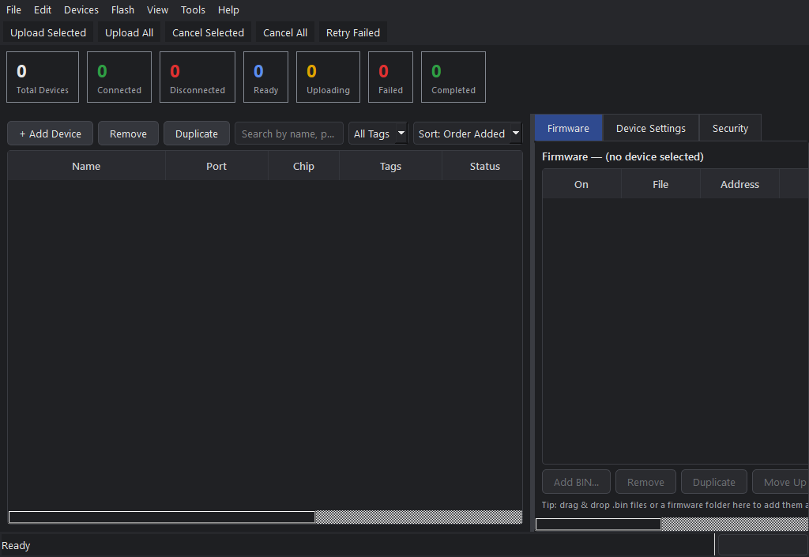

The **Help** menu gives quick access to this manual and the About dialog:

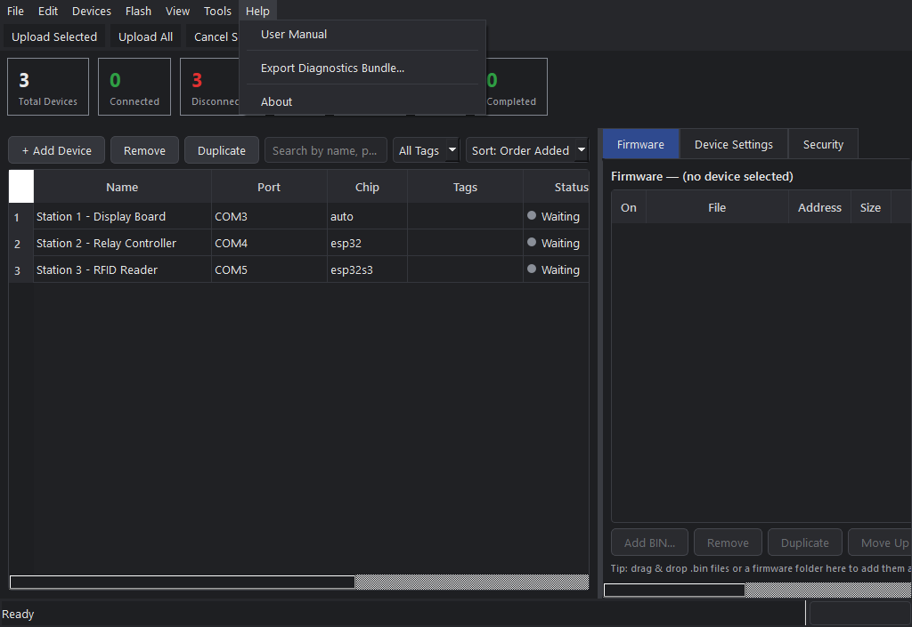

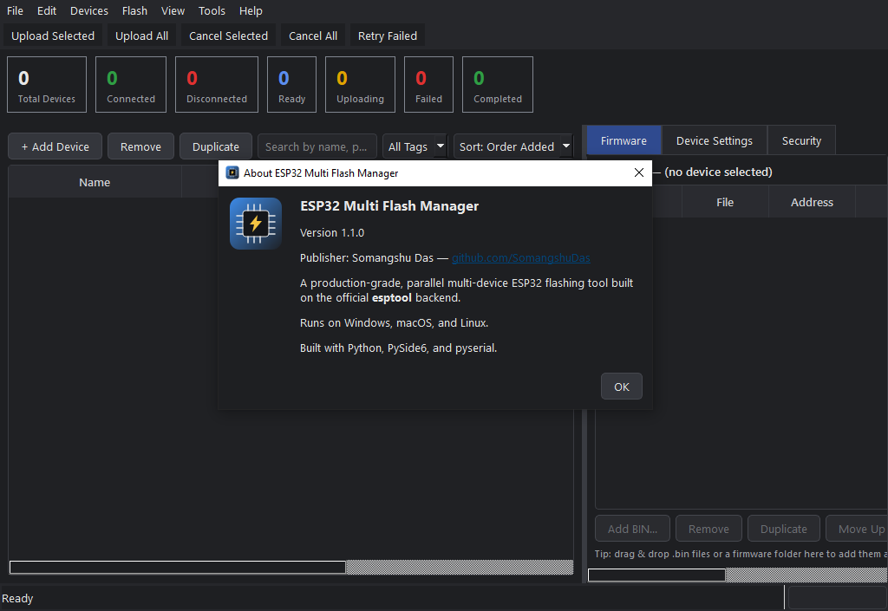

## 2. The main window

- **Top bar (Dashboard):** live counts of Total, Connected, Disconnected,
  Ready, Uploading, Failed, and Completed devices.
- **Left panel (Device List):** one row per configured device, with its
  status badge, progress bar, elapsed time, ETA, and transfer speed. Every
  column — including Name — can be resized by dragging its header edge to
  fit your workflow. Right-click a row (or multi-select with Ctrl/
  Shift-click) for a context menu with Upload Selected / Cancel Selected /
  Open Serial Monitor (single selection only) / Read Flash / eFuse / Chip
  Info... (single selection only) / Duplicate / Remove.
- **Right panel:** three tabs for whichever device is selected —
  **Firmware** (its list of `.bin` files), **Device Settings** (port,
  chip, baud, flash mode/frequency/size, and the flashing option
  checkboxes), and **Security** (flash encryption / secure boot
  provisioning — see §5).
- **Bottom dock (Flash History):** every past flash attempt, with an
  **Export CSV** button.
- **Status bar:** overall progress for the current batch and a running
  status message.

## 3. Adding and configuring a device

1. Click **+ Add Device** (or `Ctrl+D`).
2. Select it in the list, then open the **Device Settings** tab and fill
   in: Friendly Name, Port (pick from the live dropdown or type one),
   Chip Type, Upload Speed, Flash Mode/Frequency/Size, and the flashing
   toggles (Erase / Reset / Compression / Stub Loader). You can
   also add raw extra `esptool` arguments in **Custom Flash Arguments**.
   Flash verification now happens automatically after every write (esptool
   v5+), so there is no longer a separate Verify toggle.
   The **Chip Type** list is populated at startup from your installed
   `esptool` itself, so it always matches what your copy of esptool can
   actually flash (see §24 "Troubleshooting" for what happens if a
   project uses a chip your esptool no longer supports).
3. Switch to the **Firmware** tab to add `.bin` files (see next section).

To quickly configure many similar boards, configure one device fully, then
select it and click **Duplicate** — the clone keeps every setting except
its port (which is left blank so you don't accidentally double-flash
the same port).

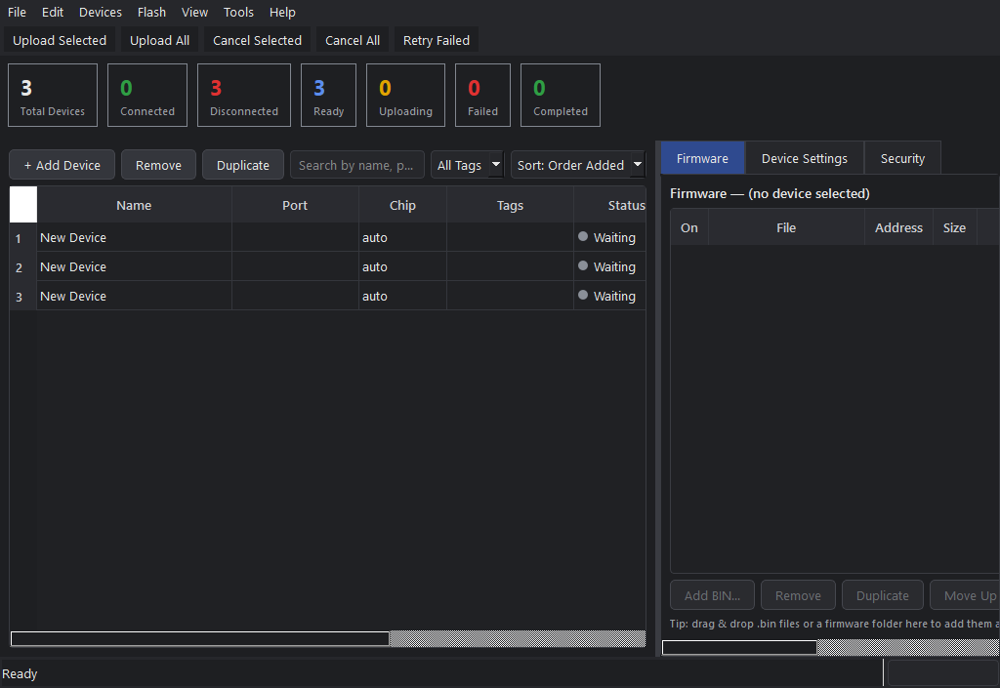

Renaming a device and setting its port/chip type on the **Device
Settings** tab:

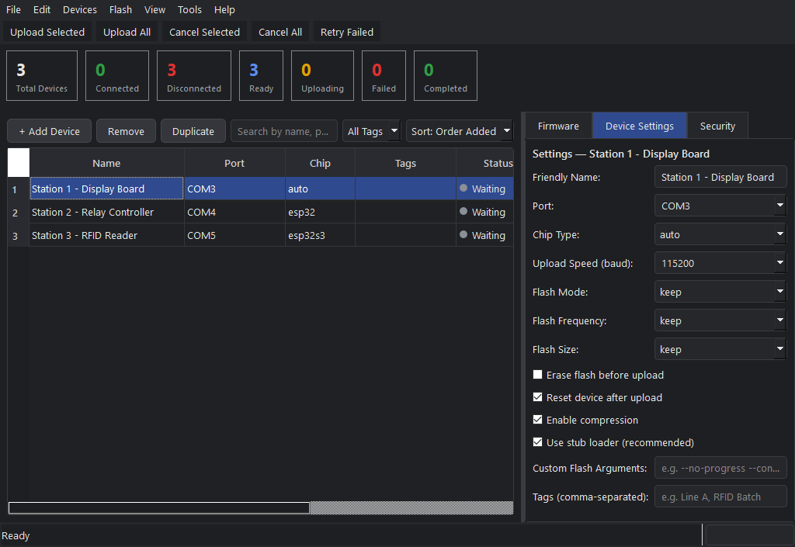

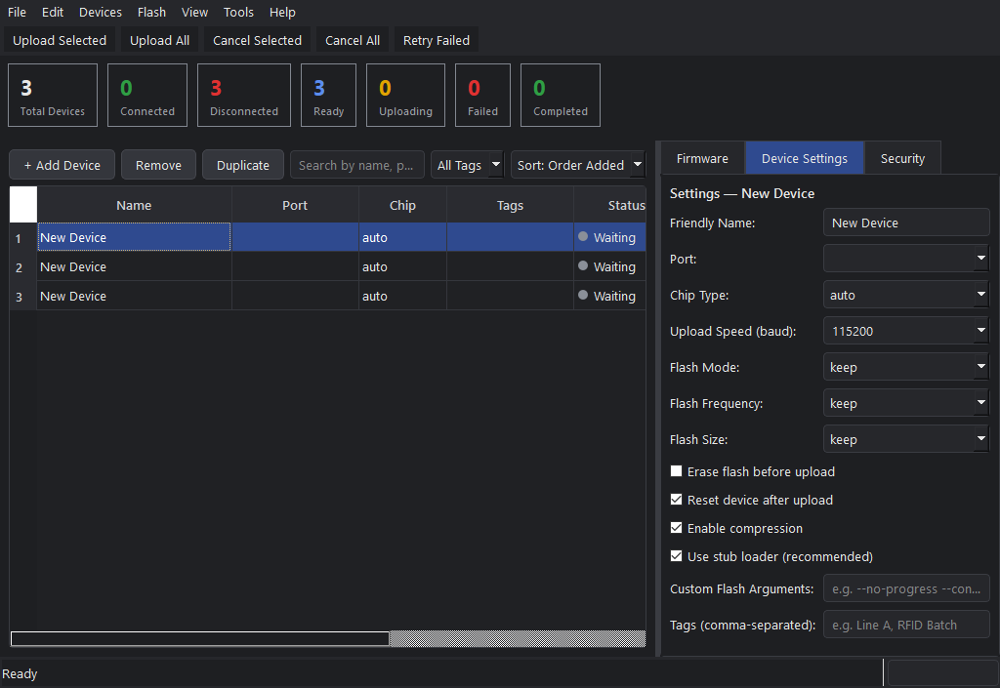

Right-click a device in the list for quick actions:

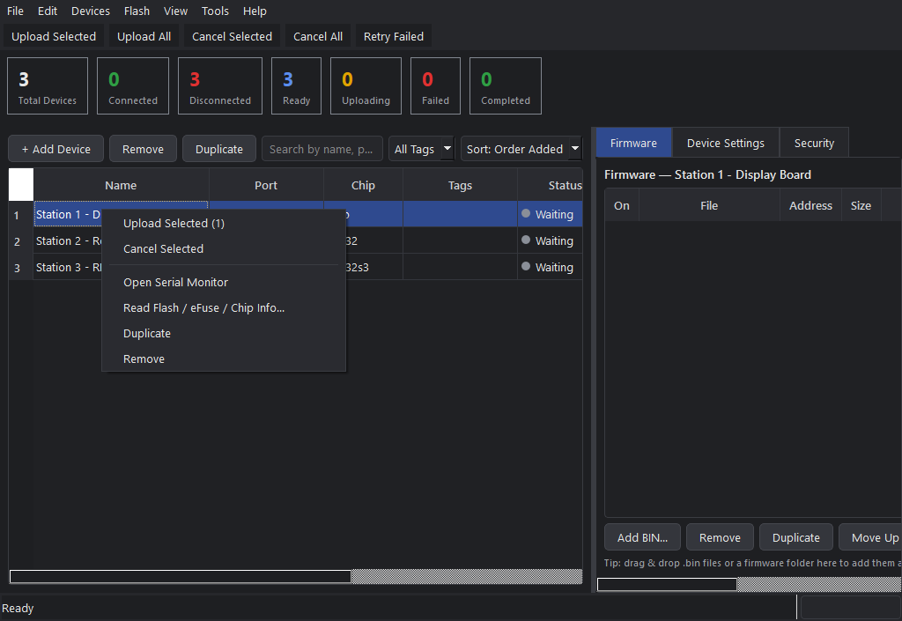

## 4. Adding firmware

On the **Firmware** tab for a device, you have four ways to add files:

- **Add BIN...** — pick one or more `.bin` files manually; you set the
  address afterwards.
- **Auto-Detect Folder...** — point at a build output directory (e.g. your
  ESP-IDF `build/` folder). Recognized filenames
  (`bootloader.bin`, `partition-table.bin`, `partitions.bin`,
  `ota_data_initial.bin`, `boot_app0.bin`, `firmware.bin`, `app.bin`) get
  their standard address automatically; anything else is added with a
  placeholder address (`0x0`) for you to fill in.
- **Drag & drop** — drag `.bin` files, or an entire firmware folder,
  straight onto the Firmware panel.
- Reorder with **Move Up** / **Move Down**, remove a row with **Remove**,
  or clone a row with **Duplicate**.

Each row has an **On** checkbox — unchecked rows are skipped when
flashing (useful for temporarily excluding a file without deleting it).

Addresses are edited in place in the table; entering something that isn't
valid hex (e.g. `0x10000`) is rejected with a warning.

**Size and MD5 checksums** shown in this table are always recalculated
fresh from the actual `.bin` file on disk — every time the project loads,
not read from what was saved last time (neither is stored in the `.emfm`
file at all). If a firmware file was rebuilt or replaced
since it was added (or since the project was last opened), its row is
flagged **"(changed!)"** so you notice before flashing a stale build by
mistake.

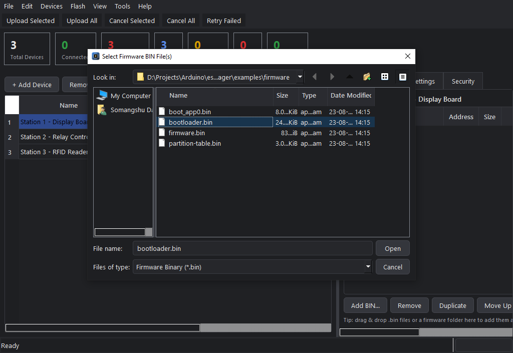

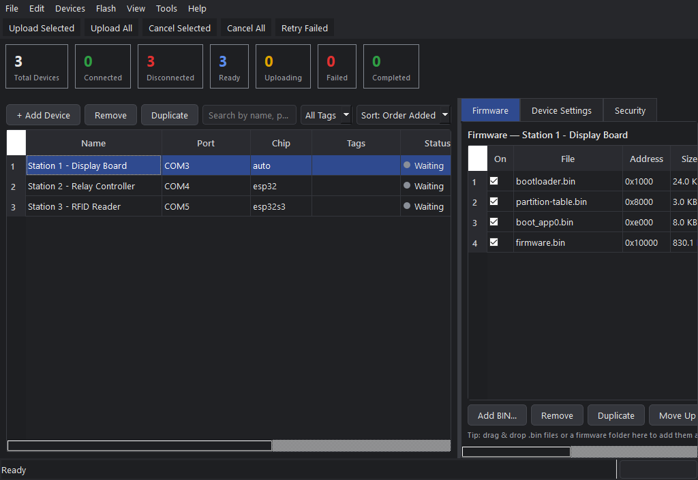

### Merging bins

Click **Merge Bins...** on the Firmware panel to combine a device's
separate firmware images (bootloader, partition table, app, ...) into one
flashable `.bin`, using `esptool`'s own `merge-bin` command:

1. Check the box on each row you want included in the merge (defaults to
   whatever is currently **On**).
2. Pick a **Target Chip** — this must be a specific chip (not "Auto"),
   since esptool needs to know the target chip to lay the merged image
   out correctly.
3. The **Output File** defaults to the same folder as `firmware.bin`
   (falling back to the first file's folder if there's no file literally
   named `firmware.bin`), using the default filename configured in
   **Settings**. Change the filename and/or location with **Browse...**
   or by editing the field directly.
4. Click **Validate** to check for problems before merging — missing
   files, invalid or duplicate addresses, and overlapping flash regions
   are all caught here, with errors (blocking) shown separately from
   warnings (which you can proceed past after confirming).
5. Choose what happens to the source rows **After Merging**:
   - *Add merged bin, de-select source bins* — the merged file is added
     as a new row and the original rows are unchecked (**On**) but kept,
     so you can still see what went into the merge.
   - *Add merged bin, remove source bins* — the merged file is added and
     the original rows are deleted from the device.
   - *Add merged bin only* — the merged file is added; the source rows
     are left exactly as they were.
   - *Do nothing to Firmware Settings* — the file is written to disk but
     nothing changes in the Firmware panel.
   The option shown by default here comes from **Settings → Default
   Post-Merge Action**.
6. Click **Merge**. The merge runs on a background thread, so the app
   stays responsive — normally it finishes in well under a second, but on
   a large image set a **Cancel Merge** button appears next to an
   in-progress indicator, letting you stop it early instead of waiting
   out the full operation.

## 5. Flash Encryption & Secure Boot (Security tab)

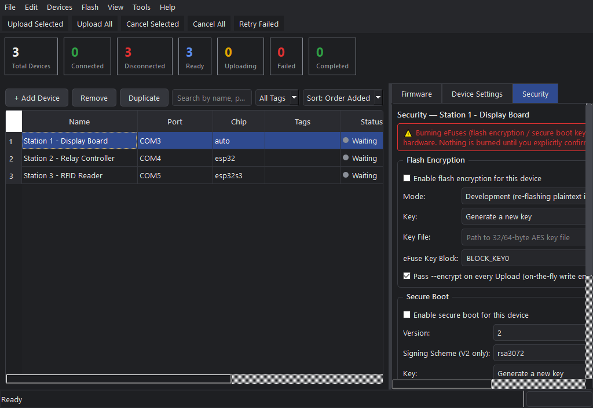

The **Security** tab (next to Firmware and Device Settings) provisions a
device's flash encryption and/or secure boot, built entirely on the same
`espsecure`/`espefuse` tools Espressif's own Flash Download Tool uses —
this app never implements any cryptography itself, it only drives those
tools. A permanent red banner on the tab reminds you that **burning eFuses
is irreversible on real hardware**; nothing is ever written to eFuse until
you explicitly confirm on the Provision dialog (see step 4 below).

1. Select a device, open its **Security** tab, and pick a specific
   **Chip Type** on Device Settings first — provisioning is disabled while
   Chip Type is "Auto", since espefuse needs to know the exact target chip
   to select the correct eFuse layout.
2. Under **Flash Encryption**, check **Enable flash encryption**, choose a
   **Mode** (*Development* keeps re-flashing plaintext images possible;
   *Release* locks that down permanently), and choose a **Key**: either
   *Generate a new key* (a fresh random AES key is created for you via
   `espsecure`) or *Use an existing key file* (browse to a key file you
   already have). On chips other than the original ESP32 you can also set
   the **eFuse Key Block** to burn into (defaults to `BLOCK_KEY0`).
3. Under **Secure Boot**, check **Enable secure boot**, pick a **Version**
   (1 or 2) and, for V2, a signing **Scheme** (RSA-3072 or one of the ECDSA
   curves), and a **Key** the same way as above — generated or existing.
4. Click **Validate Settings** to catch problems up front (missing key
   files, no chip selected, a key file that isn't the size esptool expects,
   or — if you've already read this device's state via §6 below — a
   device that already shows flash encryption enabled while this job would
   flash it in plaintext). Any text you type into a Custom Flash/eFuse
   Arguments field is also checked here against an injection allowlist, so
   a stray shell-metacharacter or path-like token is caught with a clear
   error instead of surfacing as a confusing `espefuse`/`esptool` failure.
5. Click **Provision Device (Burn eFuses)...**. The Provision dialog
   re-runs validation, then — only after you check the acknowledgement box
   **and** type the exact confirmation phrase shown on screen — starts
   burning. If this run is about to burn a **freshly generated** key (not
   an existing key file you already had a copy of), the dialog also shows
   a key-backup reminder and a second checkbox, **"I have backed up the
   generated key file(s) to a safe location,"** which must be checked
   before burning can start — the key is only ever written to disk once,
   burning is irreversible, and there's no way to recover it afterward if
   the file is lost. Progress streams live in the dialog's log, exactly
   like the main Upload console.

### 5a. Provisioning a batch of devices at once

Configuring Flash Encryption/Secure Boot and repeating steps 1–5 above for
every device in a production batch works, but is tedious once you're past
a handful of boards. **Tools → Provision Devices (Batch)...** does the
same validate → confirm → burn sequence across every eligible device in
one pass:

1. Select the devices you want to provision in the device list (or select
   none to consider every device in the project), then open **Tools →
   Provision Devices (Batch)...**.
2. The dialog runs the same pre-flight validation as the single-device
   Provision dialog on each candidate. Devices that haven't enabled Flash
   Encryption or Secure Boot at all are silently left out (there's nothing
   to burn); devices that fail validation are shown in the table, greyed
   out, with the reason why.
3. Click **Validate & Provision N Device(s)...**. You get exactly one
   confirmation gate — the same irreversible-burn checkbox, confirmation
   phrase, and (if any device is burning a freshly generated key) key-backup
   acknowledgement as the single-device dialog — covering the whole batch,
   not one popup per device.
4. Eligible devices burn eFuses in parallel, up to the **Max Parallel
   Provisions** limit (Settings → Provisioning, default 4); the rest queue
   and start automatically as running ones finish. Each row's status
   updates live, and the shared log below the table tags every line with
   the device it came from.

As with regular flashing, a device already busy (mid-upload) is left out of
the batch rather than provisioned concurrently with a flash in progress.

Under the **Advanced** group, checking **"Also store generated keys in
this computer's OS keychain (if available)"** additionally saves a copy of
every freshly generated key into the OS's own credential store (Windows
Credential Manager, macOS Keychain, or the Secret Service/KWallet on
Linux) as a second, independent backup alongside the key file. This is
off by default, best-effort, and has no effect at all on a machine whose
keychain backend isn't available or working — the key file on disk is
never affected either way.

Once flash encryption is enabled with **Pass --encrypt on every Upload**
checked (the default), the app automatically appends esptool's own
`--encrypt` flag to every subsequent Upload for that device, so ordinary
flashing keeps working through the same **Upload Selected** / **Upload
All** flow described in §7.

The **Advanced** group's *Custom eFuse Arguments* field works like Device
Settings' Custom Flash Arguments — anything typed there is appended
verbatim to the `espefuse` command line, for options this tab doesn't
expose a dedicated control for (and is checked against the same
injection allowlist mentioned above).

## 6. Read Flash / eFuse / Chip Info

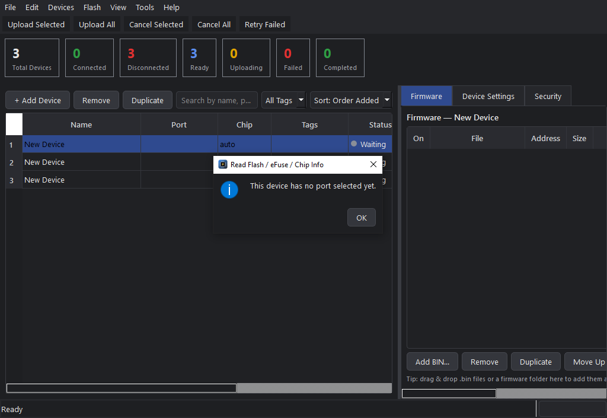

Available any time from **Tools → Read Flash / eFuse / Chip Info...** (asks
which device if more than one is configured) or by right-clicking a single
device in the list and choosing the same entry — independent of the
Upload workflow and disabled only while that specific device is mid-flash.
Everything in this dialog is **read-only**: nothing is written to flash or
eFuse.

Pick an **Operation** from the dropdown and click **Run**:

- **Chip Info** — `esptool chip-id`.
- **Flash ID** — `esptool flash-id` (SPI flash manufacturer/device ID and
  size).
- **eFuse Summary** — `espefuse summary`, a full table of every eFuse's
  current value.
- **Security Info** — `esptool get-security-info`, a focused report of the
  chip's current flash-encryption/secure-boot state. Reading this (or the
  eFuse Summary) also updates this app's own record of whether the device
  looked encrypted, which feeds the Security tab's pre-provision and
  pre-upload warnings described in §5.
- **Read Flash Region...** — `esptool read-flash <address> <size>`; enter
  the **Address** and **Size** (hex like `0x0`/`0x1000`, or decimal) and a
  **Save To File** path.

Results appear in two tabs:

- **Summary** — a plain-language rendering of the handful of fields
  people actually look for (chip model and revision, MAC address, flash
  manufacturer/size, secure boot/flash encryption state, the eFuse fields
  above, or the address/size/duration for a Read Flash Region), parsed
  from the same output shown in Log. If a particular field can't be
  confidently recognized it's simply left out rather than guessed at; if
  nothing at all could be parsed, this tab says so and points you at Log.
- **Log** — the complete, unmodified `esptool`/`espefuse` output, streamed
  live into the dialog the same way Live Output does during an Upload.

Use **Save Output As Text...** to save whatever's currently in the Log
tab, or (for eFuse Summary / Read Flash Region) the dedicated **Save To
File** field to have the read-back data written straight to disk by
esptool/espefuse itself. The default save folder follows the same
"remembers the last folder you used" behavior as Merge Bins' output field.

## 7. Uploading

- **Upload Selected** (`F5`, or the toolbar button) flashes only the
  devices currently selected in the list.
- **Upload All** (`Ctrl+F5`) flashes every configured device.
- Right-click a multi-selection for **Upload Selected (N)** from the
  context menu.

Before anything is sent to hardware, the app runs a **validation pass**
and shows a report if it finds problems:

- **Errors** (block the upload): duplicate ports, no port
  selected, missing firmware files, invalid or duplicate flash addresses,
  overlapping flash addresses (see below), invalid chip/flash-mode
  selection, an invalid baud rate (zero, negative, or absurdly large —
  caught here with a clear message instead of surfacing as a confusing
  esptool failure), no enabled firmware.
- **Warnings** (you may proceed anyway): no firmware assigned to the
  conventional bootloader (`0x1000`) or partition-table (`0x8000`)
  addresses — this is expected if you're flashing a single merged image,
  and the warning is skipped automatically when an enabled entry's file
  size shows it already covers both addresses (e.g. a merged bin at
  `0x0`); a `bootloader.bin` assigned to `0x1000` on an ESP32-S3 device
  — see the ESP32-S3 note below.

**Overlapping addresses.** Two firmware entries can use two different,
non-duplicate addresses and still collide once file size is taken into
account. The most common case: a full merged image (one `.bin` that
already contains its own bootloader, partition table, and app — the kind
esptool writes when you pass a single file at `0x0`) flashed *alongside*
a separate `bootloader.bin` at `0x1000` and/or `partition-table.bin` at
`0x8000`. The merged image is almost always well past 4 KB, so it
overwrites those addresses before esptool even gets there. The validator
now catches this before anything reaches hardware — if you see it,
either disable the separate bootloader/partition-table rows and flash
only the merged image at `0x0`, or don't enable the `0x0` merged image
alongside them.

**ESP32-S3 note.** ESP32-S3 boards have been observed to fail to boot
(hang/reset loop) when `bootloader.bin` is flashed at the classic ESP32
`0x1000` address — flashing it at `0x0` instead fixes it. **Auto-Detect
Folder...** and `.zip` manifest import already default `bootloader.bin`
to `0x0` whenever the device's chip is set to `esp32s3`; every other
chip still gets `0x1000`. If a `bootloader.bin` row is still manually
set (or imported) to `0x1000` on an ESP32-S3 device, the validation pass
warns about it directly.

Once underway, each device flashes independently and in parallel, up to
the "Max Parallel Flashes" cap set in Settings → General (default 8);
devices beyond that cap show a *Queued* badge and start automatically as
running devices finish, instead of every device launching at once. Each
device's own status badge walks through *Waiting → Preparing →
Connecting → Erasing → Uploading → Verifying → Completed* (or
*Failed*/*Cancelled*), its own progress bar fills, and its own
elapsed/ETA/speed columns update live.

If a device disconnects mid-upload and never responds again (the flash
never completes, errors, or times out), the app now abandons that
device's flash automatically after about 45 seconds of silence and marks
it *Failed* with a "device appears to have disconnected" message — it no
longer sits stuck on *Uploading* until you restart the app, and its
Serial Monitor is no longer permanently blocked as "currently uploading."

While a device's status is anywhere in *Preparing → Verifying* (i.e. an
upload is actually running against it), that device's Device Settings
panel is locked (read-only, with a "locked — flashing in progress" note
in its title) and it can't be removed from the project — this prevents
changing its port/chip/flash options or deleting it out from under the
in-progress flash. This does **not** apply to that device's Live Output
window or an open Serial Monitor on its port; both stay fully usable
while the upload runs.

## 8. Watching progress / live output

Click **View Log** on any device row to open its **Live Output** window —
the raw `esptool` console output, streamed in real time. Inside that
window you can:

- **Pause / Resume** — freeze the view without losing incoming lines
  (they're queued and flushed when you resume).
- **Search** — find text in the log (press Enter to jump to the next
  match; wraps around).
- **Copy** — copy the entire visible log to the clipboard.
- **Save Log...** — write it to a `.log`/`.txt` file.
- **Clear** — empty the console.
- **Auto-scroll** — checkbox to keep the view pinned to the latest line.

## 9. Cancelling and retrying

- **Cancel Selected** / **Cancel All** stop in-progress flashes for the
  chosen devices (the `esptool` subprocess is terminated cleanly).
- **Retry Failed** re-uploads every device currently in the *Failed*
  state.
- **Retry Selected** re-uploads whatever is currently selected,
  regardless of its last status.

## 10. Batch editing

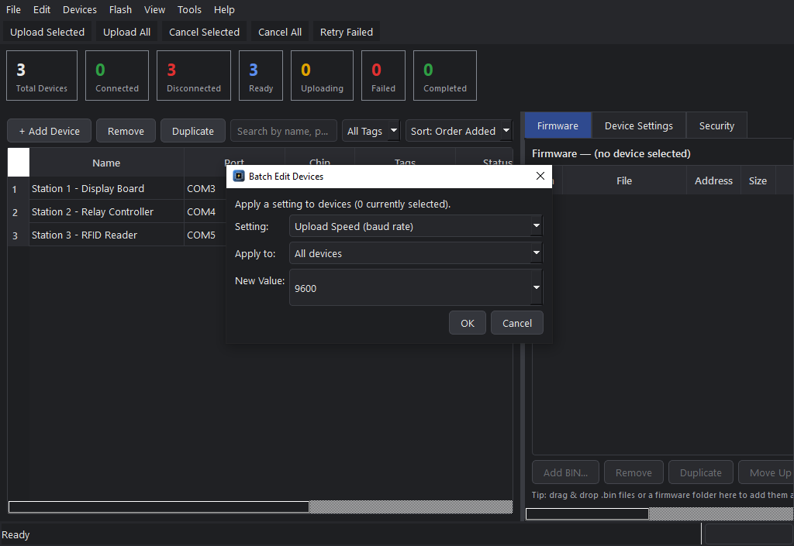

**Devices → Batch Edit...** (`Ctrl+B`) lets you change one setting (e.g.
baud rate, flash mode, or any of the boolean flags) across **All
devices** or just the **currently selected** ones, in one action — handy
when you realize halfway through setup that every board should use
230400 baud instead of the default 115200.

One field, **Tags (Add)**, behaves differently from the rest: instead of
overwriting each device's tags, it *adds* the tag you type to whatever
tags each targeted device already has (no duplicates). See §21 "Device
Groups & Tags" below for what tags are for.

After you confirm the Batch Edit dialog, a review step appears: a
"N device(s) will change" table listing only the devices whose value
would actually differ, showing the old value alongside the new one.
Nothing is applied until you click **Apply** here — **Cancel** backs out
with zero changes made, even though you already clicked OK on the first
dialog. If nothing would actually change (e.g. every targeted device
already has the value you picked), the review step is skipped entirely
and you'll see a "No devices would change" message instead.

Batch Edit (like Assign Firmware Set to Devices, §17) is undoable — see
§10b below.

### Importing devices from CSV

**Devices → Import Devices from CSV...** lets you populate the device
list in one step from a spreadsheet instead of using **Add Device**
repeatedly — handy when you have one row per unit off a production line
already tracked elsewhere.

The CSV needs a header row with a `name` column (required); `com_port`,
`chip_type`, `baud_rate`, and `tags` (semicolon-separated, e.g.
`Line A;RFID Batch`) are recognized if present but optional. Extra
columns (notes, operator names, etc.) are ignored, so you don't need to
clean up an existing tracking sheet before importing it. A row missing
`name`, or with a `baud_rate` that isn't a whole number, is skipped and
reported after the import finishes — the rest of the file still imports.

If **Default Device Profile** is set in Settings → General, it's applied
to every device imported this way, the same as it would be for a device
added by hand.

### 10a. Validating a bench before anything is connected

**Tools → Validate Bench (Dry Run)...** runs every pre-upload check
(port conflicts, chip/flash-mode/baud validity, missing firmware files,
address overlaps, security settings, ...) against **every device in the
current project**, without needing any of them to actually be plugged
in. This is different from the validation that happens automatically
when you click **Upload**: that one only checks the devices you're about
to flash, and requires their ports to be live right now; a dry run
checks the whole project regardless of what's connected to this machine
at the moment.

Use it to sanity-check a bench configuration before hardware arrives, or
to review a project file someone else built and sent you. The report
dialog looks like the normal pre-upload one, but always has a single
**Close** button — a dry run isn't gating an upload, so there's nothing
to "proceed" with.

### 10b. Undo/redo

**Edit → Undo** (`Ctrl+Z`) and **Edit → Redo** (`Ctrl+Shift+Z`) cover
four operations: **Batch Edit**, removing multiple devices at once,
**Assign Firmware Set to Devices** (§17), and importing devices from a
CSV or firmware bundle (§17a). Each menu item's label names the specific
operation it would undo/redo (e.g. "Undo Batch Edit: baud_rate"), so you
can tell at a glance what Ctrl+Z is about to do before you press it.

Undo/redo is **not** available for single-device edits made directly in
the Device Settings / Firmware / Security panels, or for adding/
duplicating one device at a time — only the four bulk operations above,
which is where an accidental change is hardest to manually reverse.

Undo history is kept as a bounded stack of full device-list snapshots
(not a record of individual field changes), and its depth is adjustable
in **Settings → Advanced → Undo History Depth** (default 25, range
1–200) if you want a longer or shorter history. Loading a different
project clears the undo history, since undoing across a project swap
wouldn't make sense.

## 11. Firmware Profiles

**Devices → Firmware Profiles...** with a device selected lets you:

- **Apply** a previously saved profile to that device (overwrites its
  firmware list and flash settings).
- **Save As New Profile...** to capture the selected device's current
  firmware list + settings under a name like "ESP32 RFID Reader", so it
  can be reused on other devices or in future projects.
- **Delete** a profile you no longer need.
- **Export...** to save any profile as a standalone, shareable JSON file
  at a location you choose — hand it to another operator or check it
  into version control without having to manually copy it out of the
  app's internal profiles folder.
- **Import...** to load a profile from a JSON file someone else exported
  (or one you exported yourself, e.g. from another machine).

## 12. Projects

- **File → New Project** (`Ctrl+N`) starts fresh (asks first if you have
  unsaved changes).
- **File → Open Project...** (`Ctrl+O`) loads a `.emfm` file.
- **File → Save Project** (`Ctrl+S`) / **Save Project As...**
  (`Ctrl+Shift+S`).
- **File → Recent Projects** lists your last 10 opened/saved projects.
  The same location is only ever listed once, even if it's referenced
  with different slash styles at different times (e.g.
  `C:/Users/you/bench.emfm` vs `C:\Users\you\bench.emfm` are treated as
  the same entry).

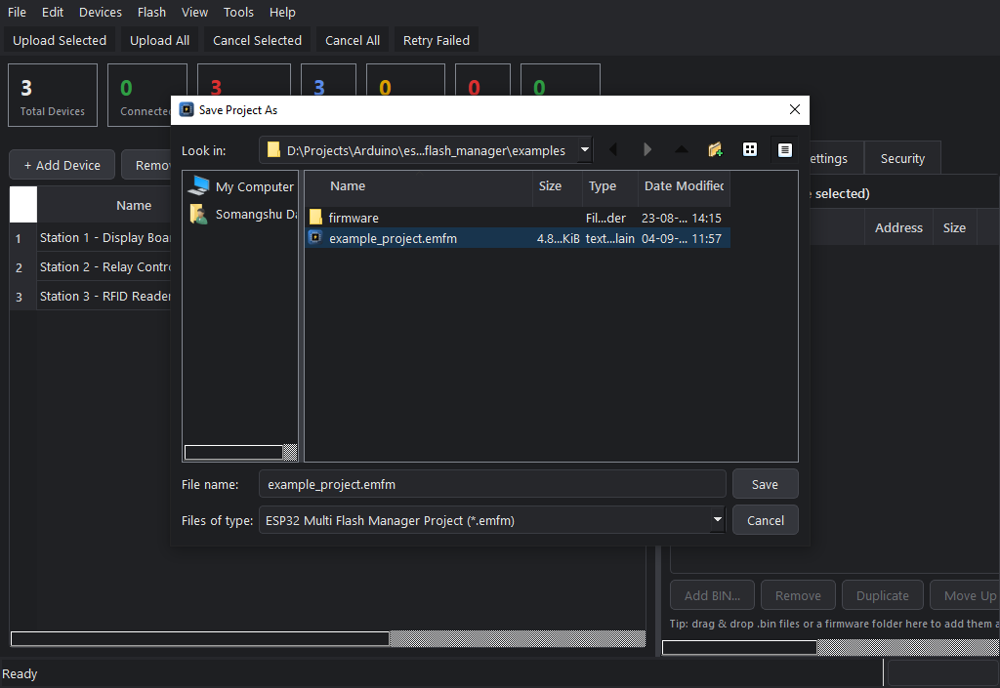

If a project references firmware files that no longer exist at their
saved path (e.g. you moved the build folder), the project still loads —
you'll get a warning dialog listing what's missing, and the affected rows
are marked **Missing!** in red on the Firmware tab. Use **Add BIN...** to
relink them. Firmware paths are stored relative to the `.emfm` file's own
directory whenever possible, so moving or copying the whole project
folder (including its firmware) to a new location, or handing it to a
coworker whose checkout lives somewhere else entirely, does not break
these references on its own — only an actually-missing file does.

**Opening an older project file.** A project last saved by a much older
release of this app opens and works normally — any structural changes
needed are applied automatically, invisibly, as soon as it's opened.
Saving it again (`Save`/`Save As...`) brings the file itself fully up to
the current version's format. The reverse case is also handled: opening a
project that was last saved by a *newer* version of this app than the one
you're currently running shows a one-time warning that some newer
settings may not be preserved if you save over it with this older
version.

**The old `.efmproj` format.** Support for the original pre-rename
`.efmproj` project file extension — including opening one at all, and
the forced-Save-As migration flow older versions of this app used for
it — was discontinued in 1.0.0. Only `.emfm` is recognized now; if you
still have old `.efmproj` files around, open them with the last 0.x
release first and use **Save As...** to migrate them to `.emfm` before
upgrading.

**Opening the same project from two places at once.** If you (or a
teammate) open the same project file from a shared network drive while
someone else already has it open, you'll see a warning naming who
appears to already have it open and since when. This is advisory only —
the project still opens normally either way — since there's no way to
truly lock a file reliably on every kind of shared drive; it exists so
two people don't silently overwrite each other's edits without at least
being told.

**Opening a project by double-clicking it.** If the app was installed via
one of the OS installers built from `packaging/` (rather than run from
source or a raw portable binary), `.emfm` files are registered with the
app:

- **Windows:** double-click a `.emfm` file in Explorer, or right-click →
  Open With → ESP32 Multi Flash Manager.
- **macOS:** double-click it in Finder, or drag it onto the app's Dock icon.
- **Linux:** works once the AppImage is integrated with your desktop (e.g.
  via `appimaged`/AppImageLauncher) — double-click from your file manager.

Either way this launches the app with that project already open — the
project on the command line is treated exactly like `File → Open Project`,
including the same missing-firmware warning behavior above.

## 13. Searching devices

Type into the search box above the device list to filter by name,
port, chip type, current status, or tag — the list narrows as you type.
The **tag dropdown** next to the search box narrows the list further to
just one tag/group at a time (e.g. "Line A"), and combines with whatever
you've typed in the search box. The **sort dropdown** re-orders the table
by Order Added, Name, or Tag — this only changes how the table is
*displayed*; it never changes the actual saved device order (so "Upload
All" and your project file are unaffected). See §21 for more on tags.

## 14. Flash history

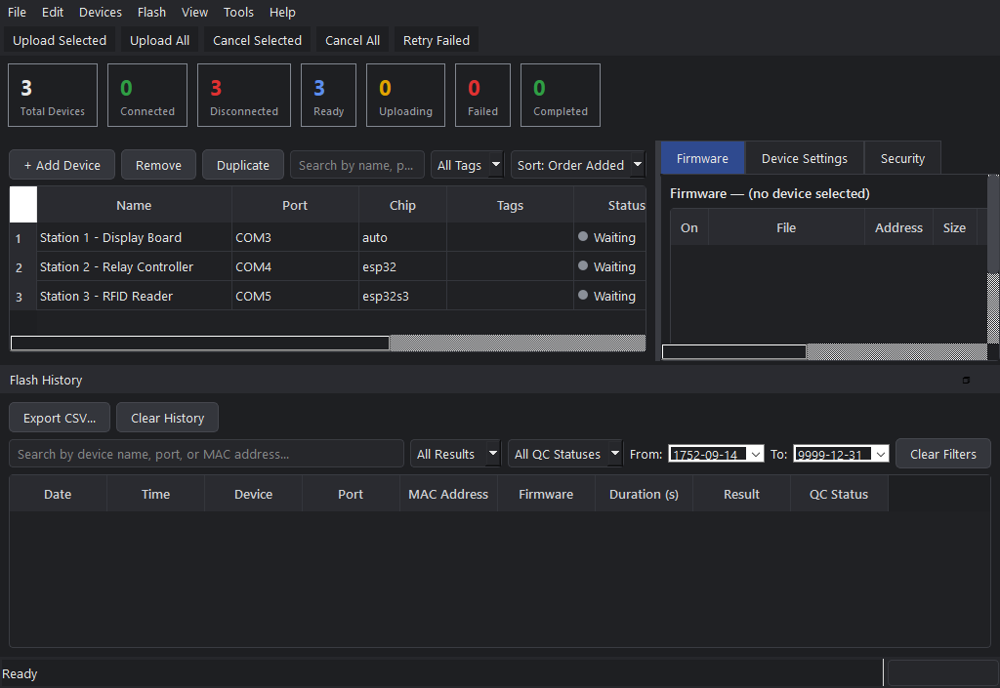

The **Flash History** dock (bottom of the window, toggle via **View**
menu) accumulates every attempt across the session: date, time, device
name, port, **MAC address**, firmware summary, duration, result, and
**QC Status**. Click **Export CSV...** to save it for QA/traceability
records, or **Clear History** to reset it. Timestamps include your
machine's UTC offset, so CSV exports collected from benches in different
time zones can be reliably compared and sorted together.

**Searching & filtering.** Above the table: a text box searches by device
name, port, or MAC address; dropdowns narrow by Result (Completed/Failed/
Cancelled) and QC Status; and a From/To date range narrows by when the
attempt happened. All filters combine (AND). **Clear Filters** resets
everything back to showing the full history.

**QC Verification.** Once a device's flash **Completed** successfully, its
row gets an active **QC Status** dropdown — mark it **Pass** or **Fail**
after you've physically checked the board (LEDs light up, RFID reads
correctly, whatever your bench test is). Rows that never completed a
flash stay at **Not Tested** and can't be marked, since there's nothing to
QC yet. QC Status is included in the CSV export.

**Device Traceability.** Each successful flash automatically records the
device's **MAC address**, captured the same way as the Chip Info panel
reads it (§6) — no extra step needed, esptool reports the MAC during
every connect, including a normal flash. This lets you trace a specific
physical board back to exactly which firmware/session flashed it, even
weeks later.

## 15. Settings

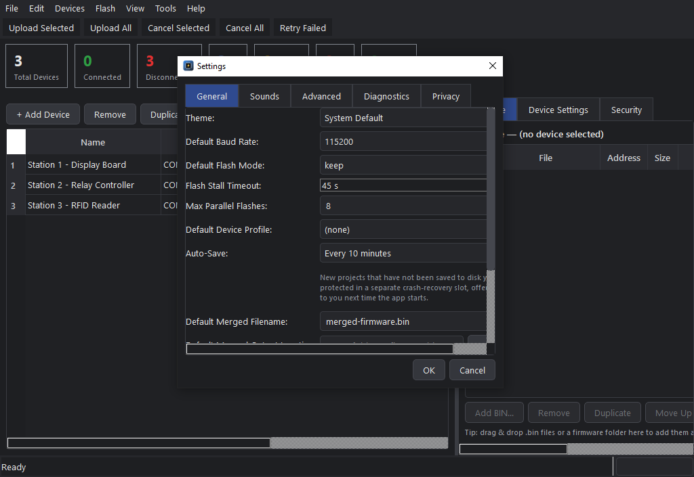

**Tools → Settings...** is organized into five tabs:

**General:**
- **Theme** — **System Default** (follows your OS's light/dark setting,
  live — no restart needed if you switch your OS theme while the app is
  open), or explicit **Dark**/**Light**.
- Default baud rate and default flash mode for new devices.
- **Default Device Profile** — optionally pick a saved Firmware Profile
  (see §11) to automatically apply to every newly-added device, instead
  of the app's built-in defaults. Leave on **(none)** to keep the
  previous behavior.
- **Auto-Save** — Disabled, or every 1/2/5/10 (default)/15/30 minutes. A
  brand-new project that hasn't been saved to disk yet is protected in a
  separate crash-recovery slot instead of a real save — see §22.
- **Flash Stall Timeout** — how long (in seconds) a flash or read
  operation can go with no output before it's treated as an
  unresponsive/disconnected device and aborted (default 45s).
- **Max Parallel Flashes** — how many devices can flash at the same time
  (default 8, adjustable 1–64). Devices beyond this cap show a *Queued*
  status and start automatically as running devices finish, instead of
  all launching at once — protects against exhausting OS threads or USB
  bandwidth on a large bench.
- **Bin Merge defaults** — default merged filename, default output
  location (leave blank to always use the same folder as `firmware.bin`),
  and the default **Post-Merge Action** pre-selected in the Merge Bins
  dialog (see §4 "Merging bins").
- **Provisioning** (its own group within the General tab):
  - **Max Parallel Provisions** — how many devices can have eFuses burned
    at the same time during batch provisioning (§5a, default 8,
    adjustable 1–32, matching Max Parallel Flashes so a bench sized for
    parallel flashing doesn't unexpectedly bottleneck on provisioning).
    Same queuing behavior as Max Parallel Flashes above.
  - **Provision Stall Timeout** — how long (in seconds) an eFuse-burning
    operation can go with no output before it's treated as unresponsive
    and aborted (default 60s).

**Sounds:** see §23 "Sounds & Notifications" below.

**Advanced:** internals previously hardcoded, exposed for benches with
unusual hardware or timing needs. Defaults match the app's previous
built-in behavior, so leaving this tab untouched changes nothing.
- **Port Scan Interval** — how often the app polls the OS for available
  serial ports (default 2000 ms).
- **Live Log Max Lines** — how many lines of live serial/console output
  are kept on screen per device before older lines are dropped (default
  10,000).
- **Project Lock Stale After** — how old a project's `.lock` sidecar file
  must be (with no matching running process on the same machine) before
  it's treated as abandoned and the project can be reopened.
- **Undo History Depth** — how many Batch Edit / Assign Firmware Set /
  bulk-remove / import steps `Edit → Undo` (§10b) can step back through
  (default 25, range 1–200). Each step keeps a full copy of the device
  list, so a very high value trades memory for a longer undo history.

**Diagnostics:**
- **Enable structured JSON logging** — writes an additional
  `events.jsonl` log alongside the four regular text logs, useful if you
  pipe logs into a log-aggregation tool. Off by default; the text logs
  are always written regardless of this setting.
- **Open Logs Folder** — opens the log directory directly, if you need to
  send logs to support.
- **Export Diagnostics Bundle...** — saves a single `.zip` containing all
  current log files plus app/OS/Python/`esptool` version information,
  convenient to attach to a bug report. Also reachable from **Help →
  Export Diagnostics Bundle...**.

**Privacy:**
- **Share anonymous usage & crash data** — off by default. See
  `docs/PRIVACY.md` for exactly what is (and is not) recorded, and note
  that this build stores events locally only — nothing is transmitted
  over the network regardless of this setting.
- **Clear Local Telemetry Data** — deletes any locally-recorded telemetry
  events immediately.

## 16. Serial Monitor

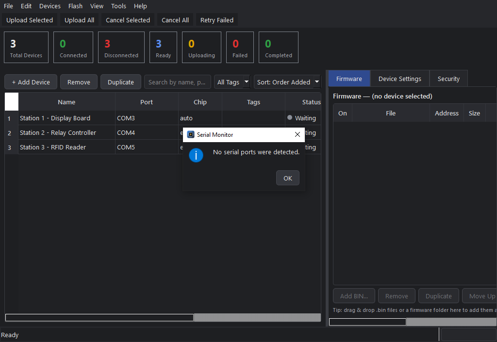

**Tools → Open Serial Monitor...** (or right-click a device row →
**Open Serial Monitor**) opens a live, two-way view of a board's serial
output — the same job as the Arduino IDE's or PlatformIO's serial
monitor, built in so you don't need a second tool. Pick the port (and,
from the device row, its saved baud rate is pre-filled) and click
**Connect**; you can open as many of these windows as you have ports
for, each independent, with its own baud-rate selector, auto-scroll,
Pause/Resume, search, Copy, Save Log..., Clear, and a send line (with a
line-ending choice) for talking back to the device.

Two safeguards keep it from colliding with flashing:
- Opening a monitor on a port that's currently mid-upload is refused —
  wait for the upload to finish first.
- Starting an upload on a port that already has a *connected* Serial
  Monitor open is refused by the pre-upload validation page, which
  tells you exactly which port's monitor to close first.

## 17. Assign Firmware Set to Devices

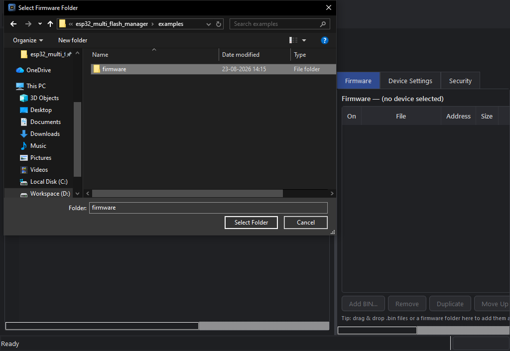

**Devices → Assign Firmware Set to Devices...** is built for the "one
firmware set, many identical devices" workflow common on a
manufacturing bench. It imports one firmware folder with the same
auto-detect used on the Firmware tab, then asks explicitly whether to
apply the resulting `.bin` + address list to **All Devices** or just
your currently **Selected Devices** (that option only appears if you
have a selection) — no more re-importing the same folder once per
board. Every other feature works exactly as it does when importing
firmware per-device: auto-detect, the pre-upload warning page, live
per-device progress, history, everything.

Like Batch Edit (§10), confirming which devices to target opens a
"N device(s) will change" review table before anything is actually
applied — only devices whose firmware list would actually differ from
what's already assigned are listed. Apply to proceed, Cancel to back
out with nothing changed. This operation is undoable (§10b).

### 17a. Zip + manifest bulk-flashing import

**Devices → Import Firmware Bundle (.zip)...** accepts a single `.zip`
file containing firmware binaries **plus** a manifest CSV, and builds a
complete device list — firmware already assigned — in one import step.
This is the "ship everything needed for this production run as one
file" workflow: instead of separately sending a firmware folder and a
device CSV and asking a remote operator to wire the two together by
hand (§17, §10 "Importing devices from CSV"), you send one `.zip` and
they use this menu item.

The `.zip` must contain a file named `manifest.csv` at its root (or
inside a single top-level folder) with a header row and one data row
per **(device, firmware file)** pair — a device with three firmware
files occupies three rows sharing the same `device_name`:

| Column          | Required? | Meaning                                                                 |
|-----------------|-----------|--------------------------------------------------------------------------|
| `device_name`   | Yes       | Device display name.                                                     |
| `firmware_file` | Yes       | Filename of a `.bin` anywhere in the `.zip` (subfolders are searched).   |
| `address`       | No        | Flash address, e.g. `0x10000`. Falls back to the same well-known address used by auto-detect (§4) for a recognized filename like `firmware.bin` or `bootloader.bin` — chip-aware for `bootloader.bin`, same as auto-detect: `0x0` for an `esp32s3` device's `chip_type`, `0x1000` otherwise — or `0x0` for an unrecognized filename. |
| `tags`          | No        | Semicolon-separated, e.g. `Line A;RFID Batch` — only needs to be set on one row per device. |
| `chip_type`     | No        | e.g. `esp32s3` — only needs to be set on one row per device.             |
| `enabled`       | No        | `true`/`false`, defaults to `true`.                                       |

A row with a missing `device_name` or `firmware_file`, or one whose
`firmware_file` isn't actually anywhere in the `.zip`, is skipped and
reported after the import finishes — same "skip the bad row, keep the
rest of the file" behavior as CSV device import. This operation is
undoable (§10b).

## 18. Locking the interface

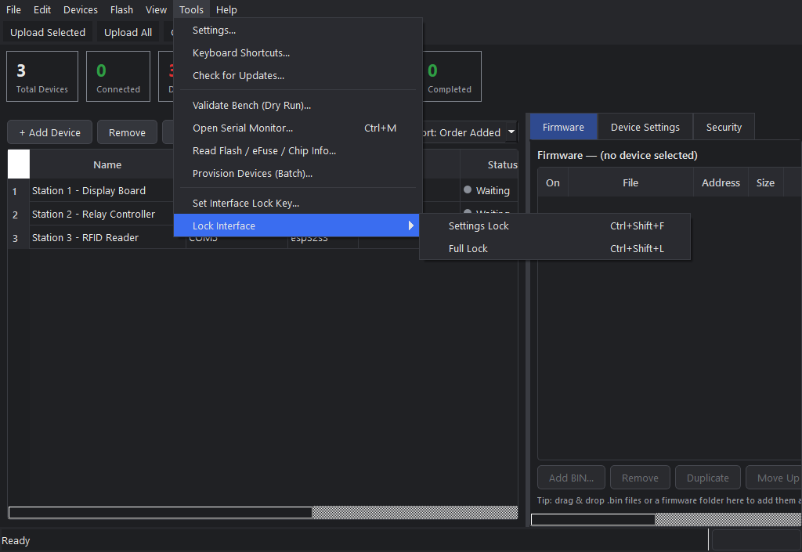

There are two lock modes, both under **Tools → Lock Interface**, and both
protected by the same unlock key.

**Settings Lock** keeps the app fully usable — uploads,
Serial Monitor, and viewing logs all keep working — but disables anything
that reconfigures what gets flashed: ports, chip/flash settings, the
firmware list (including Merge Bins), the Security tab (flash encryption
/ secure boot settings and provisioning), **Batch Edit**, **Assign
Firmware Set to Devices**, **Firmware Profiles**, and deleting devices.
This is meant for handing a bench to an operator who should run a job
that's already configured for them, without being able to change it.
Turning it off asks for the unlock key.

**Full Lock** freezes the entire window — menus,
toolbars, device list, firmware/settings panels, everything — behind a
full-screen "Interface Locked" prompt, so you can walk away from a
running batch on a shared bench PC without someone bumping a setting or
cancelling an upload. If a Logs or Serial Monitor window is still open
when you try to lock, locking is refused and you're told which window(s)
to close first — those are separate windows the lock can't reach, so
leaving one open would leave a hole in it.

The first time you use either lock mode, you'll be asked to set an
**unlock key** (**Tools → Set Interface Lock Key...**, entered twice to
confirm). The key itself is never stored — only a salted, deliberately
slow hash of it — so locking later just asks for that same key back. If
you set your unlock key on an older release of this app, it still works
exactly as before; it's silently upgraded to the current, stronger
hashing format the next time you unlock successfully, with nothing for
you to do. Closing the window (including the OS close button) is blocked
while Full Lock is active; unlock first, then exit normally if you need
to. The two modes are independent and can be combined (e.g. Settings Lock
on, then Full Lock on top before walking away).

Separately, whether or not either lock is active: **Batch Edit**,
**Assign Firmware Set to Devices**, and **Firmware Profiles** always
refuse to modify a device that's currently uploading — that device is
skipped with a warning rather than having its settings rewritten out from
under a running upload. Saving your project is never restricted.

## 19. Keyboard shortcuts

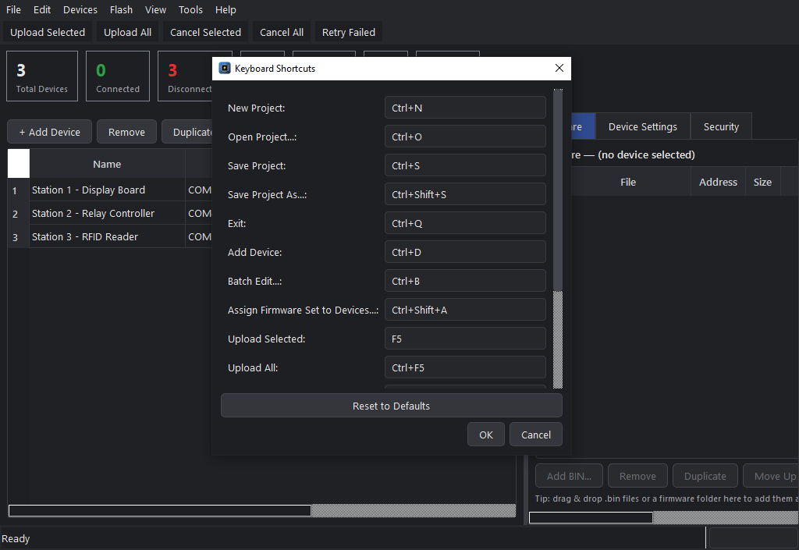

**Tools → Keyboard Shortcuts...** lets you remap any action below to a
key sequence of your choice; the app warns you (and blocks Save) if two
actions end up sharing the same shortcut. **Reset to Defaults**
restores everything shown here. Any action not listed here (e.g. Cancel
Selected, Retry Failed) has no default shortcut and isn't customisable.

Two additional shortcuts have a fixed default and are **not** listed in
the Keyboard Shortcuts dialog: `Ctrl+Z` (**Edit → Undo**) and
`Ctrl+Shift+Z` (**Edit → Redo**) — see §10b.

| Default Shortcut | Action |
|---|---|
| `Ctrl+N` | New Project |
| `Ctrl+O` | Open Project |
| `Ctrl+S` | Save Project |
| `Ctrl+Shift+S` | Save Project As |
| `Ctrl+D` | Add Device |
| `Ctrl+B` | Batch Edit |
| `Ctrl+Shift+A` | Assign Firmware Set to Devices |
| `F5` | Upload Selected |
| `Ctrl+F5` | Upload All |
| `Esc` | Cancel All |
| `Ctrl+T` | Toggle Dark/Light Theme |
| `Ctrl+M` | Open Serial Monitor |
| `Ctrl+Shift+L` | Full Lock |
| `Ctrl+Shift+F` | Settings Lock |
| `Ctrl+Q` | Exit |

## 21. Device Groups & Tags

Assign free-text tags to any device on its **Device Settings** tab (e.g.
`Line A`, `RFID Batch`) — comma-separated if a device belongs to more than
one group. Tags are purely organizational: they never change how a device
flashes.

Use them to:
- **Filter** the device list down to one tag via the dropdown next to the
  search box (§13), or type a tag into the search box itself.
- **Sort** the device list by tag (the sort dropdown, §13) to visually
  cluster devices that share a tag, without changing the underlying saved
  device order.
- **Batch-add** a tag to many devices at once via **Devices → Batch
  Edit... → Tags (Add)** (§10) rather than tagging one at a time.

Duplicating a device (§3) copies its tags to the clone, since a duplicate
is usually another unit on the same line/batch. Tags are saved with the
project file like any other device setting.

## 22. Auto-Save

**Tools → Settings → General → Auto-Save** silently saves your current
project on an interval you choose: Disabled, or every 1, 2, 5, 10
(default), 15, or 30 minutes.

Two things worth knowing:
- **A brand-new, never-saved project is protected too, just not the same
  way.** If you haven't run **File → Save Project** yet, there's no file
  path to write the real project to — instead, auto-save writes to a
  separate crash-recovery slot. This is never a substitute for actually
  saving: it doesn't appear in Recent Projects and isn't the file your
  work ends up in, it just means a crash or power loss won't lose
  everything. Next time you start the app after an unexpected close,
  you'll be asked whether to recover it.
- **Auto-save when there's nothing new to save.** If the project hasn't
  changed since the last save (manual or automatic), each timer tick is a
  silent no-op.

A brief "Auto-saved." message appears in the status bar each time it
fires, so it's never a surprise. Manually saving (`Ctrl+S`) at any time
resets nothing about the timer — it just runs on its own fixed interval
in the background.

## 23. Sounds & Notifications

**Tools → Settings → Sounds** lets you turn on short notification sounds
for: a device's flash succeeding, a device's flash failing, a whole batch
finishing, and a device connecting/disconnecting over USB. A master
**Enable sounds** checkbox turns all of them on/off at once; each event
also has its own checkbox so you can enable just the ones you care about
(flash failures and batch-complete are on by default; the rest start
off).

Leave an event's sound file blank to use a simple system beep, or
**Browse...** to pick your own `.wav`/`.mp3`/`.ogg` file — handy for
something that cuts through workshop background noise better than a beep.
**Test** plays whatever's currently in that field immediately, regardless
of whether that event is enabled, so you can preview it before saving.

## 24. Troubleshooting

- **"esptool could not be launched"** — make sure `pip install -r
  requirements.txt` succeeded and that `python -m esptool version` works
  from the same environment you're running this app in.
- **A device won't connect** — check the port is correct (unplug/
  replug and watch the status bar toast; the dashboard's Disconnected
  tile also flags it), and that no other program (Arduino IDE Serial
  Monitor, PlatformIO, this app's own Serial Monitor, etc.) is holding
  the port open.
- **"No serial data received" / upload fails immediately** — this means
  esptool couldn't get a response from the board at all: check the cable
  (data cable, not charge-only), that the board is in bootloader mode if
  it requires manually holding BOOT, and that the correct port is
  selected. This is reported directly in the device's status, Live
  Output, and history — not as an application error.
- **"Close the Serial Monitor before uploading"** — this app's own
  built-in Serial Monitor (§14) is connected to the same port you're
  trying to flash; esptool can't share a port with anything else.
  Disconnect or close that Serial Monitor window, then upload again.
- **"Unsupported/invalid chip selection" or a startup warning about an
  unsupported chip** — the app asks your installed `esptool` at startup
  which chips it supports (see §3); if a project uses a chip your
  installed esptool doesn't report support for, you're warned on load and
  the validator blocks uploading to that device. Update `esptool`
  (`pip install --upgrade esptool`) or correct the chip type in Device
  Settings.
- **Duplicate port error at upload time** — two devices in your
  selection share the same port; only one can use it at once. Fix one
  of them in the Device Settings tab.
- **"overlaps" error in the validation report** — a firmware entry's
  address plus its file size runs into the next entry's address. This
  happens most often when a full merged image (already containing its
  own bootloader/partition table) is enabled at `0x0` at the same time
  as separate `bootloader.bin`/`partition-table.bin` rows — disable one
  or the other, don't flash both.
- **An ESP32-S3 board hangs/reset-loops after flashing instead of
  booting** — check whether `bootloader.bin` is assigned to `0x1000`;
  ESP32-S3 needs it at `0x0` instead (see the ESP32-S3 note in §7). New
  auto-detected/imported bootloaders on an ESP32-S3 device already use
  `0x0` by default, but a project migrated from an ESP32/ESP32-C3
  firmware set, or one edited by hand, can still have the old address.
- **A device's Settings panel is locked / grey / won't accept edits** —
  that device is currently flashing (status somewhere between
  *Preparing* and *Verifying*). Wait for it to finish or cancel it first;
  the panel unlocks automatically the moment it's no longer busy.
- **Can't remove a device** — same cause as above: a device that's
  mid-flash can't be removed while its upload is in progress.
- **A device is stuck on "Uploading" and its Serial Monitor keeps
  saying "currently uploading firmware"** — if the device disconnected
  mid-flash, the app auto-fails that device after about 45 seconds of no
  response instead of hanging indefinitely; give it that long before
  assuming something's wrong. If it's still stuck well past that, it's
  worth reporting as a bug rather than restarting the app.
- **Forgot the interface lock key** — there is no recovery/reset path by
  design (that's the point of a lock). You'll need to close the app from
  the OS (e.g. Task Manager / `kill`, losing unsaved project changes) and
  relaunch it.
- **"espsecure/espefuse could not be launched"** — same root cause as the
  esptool version above: confirm `python -m espsecure version` and
  `python -m espefuse version` both work in the same environment (both
  ship inside the `esptool` package, so reinstalling/upgrading `esptool`
  fixes this too).
- **"Provision Device" button is greyed out** — either no Chip Type is
  selected (pick a specific chip, not "Auto", on Device Settings), or
  neither Enable Flash Encryption nor Enable Secure Boot is checked on the
  Security tab yet.
- **"Validate & Provision..." is disabled / shows 0 devices in the Batch
  Provision dialog** — same causes as above, applied per device: none of
  the selected (or, if nothing's selected, project) devices have Flash
  Encryption or Secure Boot enabled, or every candidate failed pre-flight
  validation (check the reason shown in that device's row).
- **Provisioning fails partway through with an eFuse-related error from
  espefuse** — this app deliberately does not retry or paper over eFuse
  errors; read the exact espefuse message in the Provision dialog's log
  (e.g. a block already burned, or a purpose mismatch) and correct the
  Security tab settings before trying again. Remember eFuse burns that did
  complete before the failure are permanent even if a later step failed.
- Logs are in the app's per-OS data folder — `Tools → Settings → Open
  Logs Folder` opens it directly on any platform. If you need the path
  manually: `%APPDATA%\ESP32MultiFlashManager\logs\` on Windows,
  `~/Library/Application Support/ESP32MultiFlashManager/logs/` on macOS,
  or `~/.local/share/ESP32MultiFlashManager/logs/` on Linux.

---

Author: Somangshu Das — [github.com/SomangshuDas](https://github.com/SomangshuDas)
